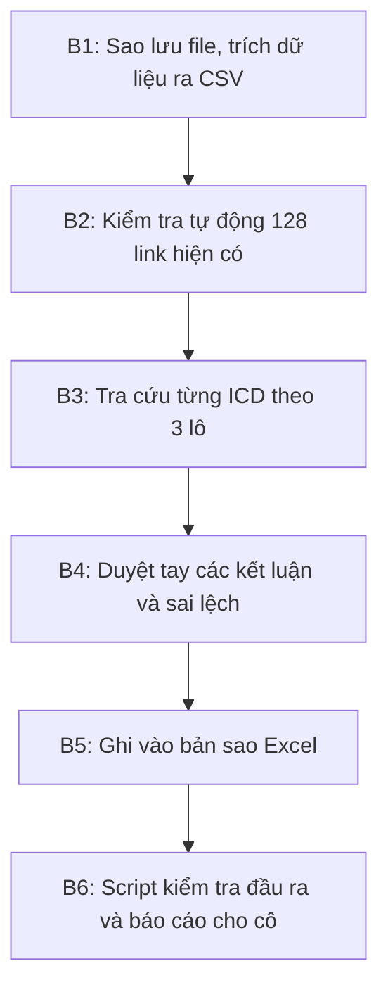
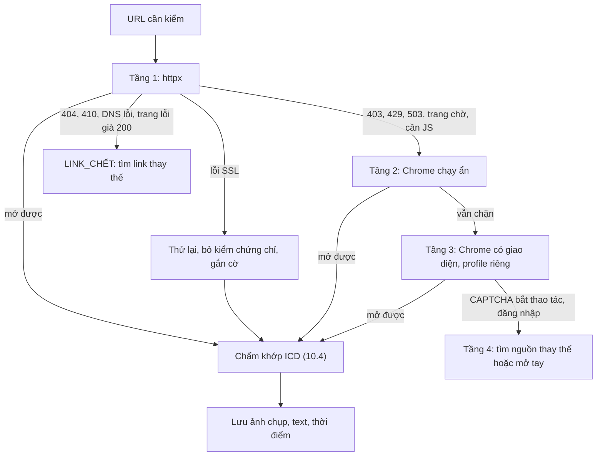

# PLAN-3: Kiểm tra, bổ sung và gắn link cho 128 ICD

File: `Thông tin ICD 34 tỉnh năm 2026.xlsx`

Plan này thay cho `plan.md` (bản Gemini) và `plan-2.md` (bản nhận xét). Nó giữ khung "hai lớp" của plan 1, áp các nguyên tắc an toàn của plan 2, và thêm phần plan 1 lẫn plan 2 đều chưa có: **kiểm tra thông tin sai**.

---

## 1. Yêu cầu của cô và đầu ra tương ứng

Cô cần ba việc:

1. **Tra tự động và gắn link để kiểm tra thông tin có đúng không.** Đầu ra: mỗi ICD có link riêng, và mọi link (cũ lẫn mới) được script kiểm tra xem còn truy cập được không và có nhắc đúng tên ICD không.
2. **Biết ICD nào đang hoạt động, ICD nào chưa; bổ sung thông tin còn thiếu, có link website hoặc link thông tin.** Đầu ra: cột trạng thái hoạt động, cột link website/thông tin, và các ô đang trống trong sheet chi tiết được điền thêm, mỗi thông tin đều ghi nguồn.
3. **Kiểm tra xem có thông tin nào không đúng.** Đầu ra: cột kết quả kiểm tra trên sheet `Tổng hợp`, và sheet mới `Kiểm tra sai lệch` liệt kê từng chỗ sai, kèm nguồn và đề xuất sửa.

---

## 2. Hiện trạng file (đã kiểm bằng script)

- Sheet `Tổng hợp` có 128 dòng, cột A–E: STT, Tên ICD, Miền, Pháp lý, Link đối chiếu. Tiêu đề merge `A1:E1`.
- Có 127 sheet chi tiết, thiếu **sheet 08 (Cảng cạn Tân Cảng Quế Võ)**. Mỗi sheet có 14 dòng: 12 hạng mục đánh số và một dòng `Tình trạng` không đánh số. Cột A–C, font Times New Roman 14.
- Pháp lý: 19 dòng `QĐ 428/QĐ-BXD` (đã công bố mở), 91 dòng `QH ngành 979`, 18 dòng `QH tỉnh`.
- Link hiện có đều là link pháp lý. **91 dòng QH 979 dùng chung một URL** (`vanban.chinhphu.vn/?docid=208522`), nên không dùng được để kiểm chứng từng ICD.
- Số ô đã có chữ trên 127 sheet:
  - Chủ đầu tư: 18
  - Đơn vị khai thác: 6
  - Dịch vụ cung cấp: 18
  - Hãng tàu: 18, nhưng cả 18 ô đều chỉ ghi "Chưa xác minh..."
  - Quy mô: 24
- Ở nhóm STT 20–128, gần như chỉ có Tên, Tình trạng, Vị trí và Số QĐ.

---

## 3. Quy tắc bắt buộc

1. **Không ghi đè ô gốc.** Mọi ô đang có chữ (A–E ở `Tổng hợp`, các dòng 1–14 ở sheet chi tiết) giữ nguyên. Chỗ sai được ghi vào sheet `Kiểm tra sai lệch` kèm đề xuất sửa. Cô duyệt xong mới sửa.
2. **Chỉ điền vào ô đang trống**, hoặc thêm vào cột/dòng mới.
3. **Không có link thì không điền.** Mỗi thông tin bổ sung phải ghi nguồn ở cuối, ví dụ `(nguồn: tancang.com.vn, 10/2026)`. URL đầy đủ nằm ở dòng "Nguồn kiểm chứng" của sheet đó.
4. **Link mới phải nói riêng về ICD đó.** Không dùng lại URL chung của QĐ 979.
5. **"Đã công bố mở" chưa có nghĩa là "đang hoạt động".** Trạng thái hoạt động phải có bằng chứng vận hành riêng (xem mục 4).
6. **Giữ bản đồ 34 tỉnh.** Khi tra cứu thì tìm theo cả tên tỉnh cũ và tỉnh mới, nhưng khi ghi vào file thì dùng địa danh mới như file đang dùng.
7. **Cẩn thận với tên trùng.** Mỗi kết quả tra cứu phải khớp cả tên lẫn địa bàn:
   - Long Bình: STT 15 (Đồng Nai), 98 (TP.HCM cũ), 126 (An Giang)
   - Tân Lập: STT 58 (Hưng Yên), 121 (Long An)
   - Thạnh Phước (18) khác Thanh Phước – Gò Dầu (116)
   - Cái Mép (17) khác Phước Hòa – Cái Mép (115)
   - Thanh Thủy: STT 21 (Tuyên Quang), 71 (Nghệ An)
   - Quế Võ (08) không được lẫn với Mộc Bài (19)
8. Làm trên **bản sao**: `Thông tin ICD 34 tỉnh năm 2026 - đã kiểm tra.xlsx`. File gốc giữ nguyên.

---

## 4. Thang trạng thái hoạt động (cột mới)

Mỗi ICD được gán đúng một giá trị:

- **Đang hoạt động**: có ít nhất một bằng chứng vận hành, gồm:
  - website doanh nghiệp đang giới thiệu ICD đó, có địa chỉ khớp; hoặc
  - văn bản hoặc danh sách của Hải quan về địa điểm/chi cục tại ICD; hoặc
  - bài báo chính thống trong vòng 24 tháng nói về khai thác hoặc sản lượng.
- **Đã công bố mở, chưa xác nhận đang khai thác**: có quyết định mở cảng nhưng chưa tìm được bằng chứng vận hành.
- **Đang xây dựng / chuẩn bị đầu tư**: đã có chủ đầu tư, chủ trương đầu tư, đã khởi công hoặc đang giải phóng mặt bằng, có bài báo hoặc văn bản đi kèm.
- **Chưa triển khai (mới quy hoạch)**: đã tra mà không thấy dự án. Link là văn bản quy hoạch, ghi kèm ngày tra.
- **Chưa đủ thông tin**: nguồn mâu thuẫn hoặc không tra được. Không được đoán.

Nếu gặp ICD đã ngừng hoạt động hoặc đang di dời, ghi `Đã ngừng / di dời` kèm nguồn. Không tạo nhóm "đặc thù" chung chung như plan 1.

---

## 5. Cấu trúc file sau khi làm

### Sheet `Tổng hợp`: thêm 4 cột, nới tiêu đề thành `A1:I1`

- **F – Tình trạng hoạt động (10/2026)**: một trong các giá trị ở mục 4.
- **G – Link website / thông tin ICD**: website doanh nghiệp, hoặc bài báo/văn bản riêng về ICD đó.
- **H – Kết quả kiểm tra thông tin**: `Khớp nguồn`, `Có sai lệch – xem sheet Kiểm tra sai lệch`, hoặc `Chưa kiểm chứng được`.
- **I – Ghi chú kiểm tra**: tóm tắt ngắn, ví dụ "Link cột E trùng với STT 4".

Định dạng copy từ cột E: font, viền, màu nền theo dòng.

### 128 sheet chi tiết: thêm 4 dòng cuối (13–16), không chèn giữa

- 13 – Tình trạng hoạt động thực tế (10/2026)
- 14 – Website / link thông tin ICD
- 15 – Nguồn kiểm chứng: danh sách URL đã dùng để điền các ô bổ sung
- 16 – Kết quả kiểm tra thông tin

Các ô trống ở dòng 1–14 (chủ đầu tư, đơn vị khai thác, dịch vụ, hãng tàu, quy mô...) được điền nếu có nguồn, theo quy tắc 3.

### Sheet 08 Tân Cảng Quế Võ (tạo mới)

- Nhân bản từ sheet `09 Tiên Sơn` để giữ định dạng, rồi đặt vào giữa sheet 07 và 09.
- Viết cùng giọng các sheet nhóm QĐ 428: ghi số quyết định mở, câu "Không đồng nhất công bố mở với sản lượng thực tế", và mức độ chắc chắn.
- Chỉ ghi chủ đầu tư, diện tích và quyết định khi tìm được văn bản gốc. Link đang có ở cột E (bài "4 cảng cạn quy hoạch tại Bắc Ninh đang được triển khai thế nào") không đủ để kết luận.

### Sheet mới `Kiểm tra sai lệch`

Các cột: STT, Tên ICD, Sheet, Hạng mục, Nội dung hiện tại, Phát hiện, Link nguồn, Loại (Sai nội dung / Sai hoặc yếu link / Lỗi định dạng / Thiếu số liệu), Đề xuất sửa.

### Sheet mới `Thống kê`

- Số ICD theo từng trạng thái, chia theo Miền và theo nhóm pháp lý.
- Số link theo kết quả kiểm tra: còn truy cập được, lỗi, chuyển hướng.
- Số sai lệch theo loại.

---

## 6. Các điểm nghi sai đã thấy trong file (đưa vào kiểm tra đầu tiên)

0. **Link của STT 1 (Đông Phố Mới) đã chết.** Thử ngày 28/10/2026: `mt.gov.vn` trả 404 "Không tìm thấy ứng dụng Web". Cần thay bằng văn bản QĐ 1549/QĐ-BGTVT ở nguồn khác.
1. **STT 3 và 4 dùng chung link** `vimawa.gov.vn/vi/node/15406`. Mở bằng trình duyệt thì đây là bài "Bộ Xây dựng công bố danh mục 19 cảng cạn, bổ sung 2 cảng mới", tức là bài chung về QĐ 428, không riêng ICD nào. Cần link riêng cho Km3+4 Móng Cái và cho Tân Cảng Hải Phòng.
2. **Link của STT 2 (Hải Linh)** là file PDF nghị quyết HĐND Phú Thọ, không phải quyết định mở cảng.
3. **Link của STT 12 (Tân Cảng Hà Nam)** là quy hoạch tỉnh Hà Nam (QĐ 1686/QĐ-TTg), không phải QĐ mở cảng 1007/QĐ-BGTVT. Link của STT 13 là QĐ 979, cũng không phải QĐ mở cảng 684/QĐ-BGTVT.
4. **Link của STT 8 (Quế Võ)** là bài về cảng cạn quy hoạch, không phải quyết định mở cảng.
5. **STT 9 (Tiên Sơn) và STT 15 (Long Bình)** chưa có số quyết định mở cảng ("cần tra cứu số gốc"). Cần tra số và ghi đề xuất bổ sung.
6. **Lỗi số thập phân**: STT 10 ghi `8,1910900000000009 ha`, STT 18 ghi `9,6477599999999999 ha`. Đúng phải là 8,19109 ha và 9,64776 ha.
7. **STT 19 còn chữ "EXCEL GỐC" / "Excel gốc"** trong 4 ô (Kết nối, Quy mô, Dịch vụ, Khách hàng). Đây là ghi chú làm việc, không nên để trong bản nộp.
8. **Ngày và số quyết định quy hoạch tỉnh**: kiểm tra lại số, ngày và tình trạng (đã phê duyệt hay mới HĐND thông qua) của các văn bản 2279/QĐ-UBND (Khánh Hòa), 5455/QĐ-UBND (Hải Phòng), 568/QĐ-UBND (Ninh Bình), 779/QĐ-UBND (Đồng Nai), 01/NQ-HĐND (Lai Châu, Cà Mau).
9. **Số và ngày quyết định mở cảng của cả 19 ICD nhóm QĐ 428**: đối chiếu với văn bản gốc. Nhiều dòng đang ghi "theo tài liệu lịch sử".
10. **ICD có thể đang chạy nhưng file ghi là quy hoạch**: các tên như Sóng Thần (106), TBS Tân Vạn (107), Long Bình TP.HCM (98) cần kiểm tra trước. Nếu đang khai thác thì cột F ghi theo thực tế. Ô `Tình trạng` pháp lý vẫn giữ nguyên, phần giải thích ghi ở cột I.

---

## 7. Quy trình thực hiện

### B1 – Chuẩn bị

- Copy file gốc thành bản sao.
- Script `scripts/extract.py` xuất toàn bộ `Tổng hợp` và 127 sheet ra `data/icd_hien_trang.csv`, mỗi dòng là một cặp ICD và hạng mục.

### B2 – Kiểm tra link tự động

Script `scripts/check_links.py` chạy cho mọi URL ở cột E (và sau này cho cả link mới). Mỗi link được ghi lại:

- mã HTTP
- URL cuối cùng sau khi chuyển hướng
- tiêu đề trang
- trang có nhắc tên ICD hay số quyết định tương ứng không

Kết quả lưu vào `data/link_check.csv`. Link lỗi, link trùng, hoặc link không nhắc đúng ICD được đưa sang sheet `Kiểm tra sai lệch`. Chi tiết cách mở trang, xử lý trang chặn bot và cách chấm điểm ở **mục 10**.

### B3 – Tra cứu theo lô

Việc tra cứu do agent làm: tìm trên web theo mẫu câu cố định, mở trang, trích nội dung. Mỗi phát hiện ghi một dòng vào `data/tra_cuu.csv` với các cột: STT, hạng mục, giá trị, URL, ngày của nguồn, câu trích dẫn. Cách tìm link ứng viên, chọn link và xác minh website chính chủ ở **mục 10**.

Mẫu câu tìm kiếm: `"cảng cạn <tên>" <tỉnh mới>`, `"ICD <tên>" <tỉnh cũ>`, kèm một trong các từ: công bố mở, khánh thành, khởi công, chủ đầu tư, website. Nguồn ưu tiên theo thứ tự:

1. Văn bản gốc: Bộ Xây dựng / Bộ GTVT, Cục Hàng hải, Hải quan, thuvienphapluat
2. Website doanh nghiệp vận hành: Tân Cảng, Gemadept, VIMC, TBS, Hateco, Transimex...
3. Cổng thông tin tỉnh và báo chính thống (Báo Chính phủ, Đầu tư, Đấu thầu, Xây dựng)

Ba lô, theo thứ tự:

- **Lô A – 19 ICD nhóm QĐ 428 (gồm sheet 08).** Xác nhận đang hoạt động, đơn vị khai thác, website, hãng tàu nếu có nguồn. Đối chiếu số và ngày quyết định mở. Lấy link riêng cho STT 2, 3, 4, 8, 12, 13.
- **Lô B – ICD trùng tên và ICD có thể đang chạy dù ghi là quy hoạch.** Gồm các tên ở quy tắc 7 và mục 6.10, cùng mọi tên trong 109 dòng còn lại mà lần tìm đầu đã ra doanh nghiệp đang khai thác.
- **Lô C – các ICD còn lại.** Mỗi ICD tra ít nhất 2 lượt tìm kiếm. Không thấy gì thì ghi `Chưa triển khai (mới quy hoạch)` kèm link quy hoạch và ngày tra, hoặc `Chưa đủ thông tin` nếu nguồn mâu thuẫn.

### B4 – Duyệt tay (bắt buộc)

Duyệt lại các dòng sau trước khi ghi vào Excel:

- mọi dòng gán `Đang hoạt động` hoặc `Đang xây dựng`
- mọi sai lệch
- mọi ICD trùng tên

Với mỗi dòng: mở link, xác nhận tên và địa bàn khớp. Dòng nào không khớp thì hạ xuống `Chưa đủ thông tin`.

### B5 – Ghi Excel

Script `scripts/build_excel.py` dùng `openpyxl` để:

- tạo sheet 08
- thêm cột F–I và dòng 13–16
- điền vào ô trống
- tạo sheet `Kiểm tra sai lệch` và `Thống kê`
- gắn hyperlink cho mọi URL để bấm được

Định dạng copy từ ô lân cận. Không đụng vào ô đã có chữ.

### B6 – Kiểm tra đầu ra

Script `scripts/verify.py` so sánh file gốc với bản sao và kiểm tra:

- Không ô gốc nào bị đổi nội dung. Đây là phép so từng ô.
- Có đủ sheet 01–128, đúng thứ tự.
- 128/128 dòng có cột F.
- Mọi dòng có F khác `Chưa đủ thông tin` đều có link ở G, và link đó không phải URL chung của QĐ 979.
- Mọi link mới có trạng thái `MỞ_ĐƯỢC_KHỚP` hoặc `ĐÃ_XÁC_MINH_TAY` (mục 10.2). Không dùng điều kiện "HTTP 200", vì trang chặn bot trả 403 dù link vẫn sống.

Sau đó gửi cô bản sao Excel, cùng một đoạn tóm tắt: số ICD theo trạng thái, số sai lệch, và các đề xuất sửa cần cô quyết.

---

## 8. Những gì giữ, sửa, bỏ so với hai plan trước

- **Giữ từ plan 1**: khung hai lớp (pháp lý và thực tế), thêm cột trạng thái và link, tạo sheet 08, dùng openpyxl, có thống kê tổng kết.
- **Giữ từ plan 2**: tách "đã công bố mở" khỏi "đang hoạt động", khóa thêm Số QĐ / Vị trí / Quy mô, không có nguồn thì không điền, xử lý tên trùng, duyệt tay trước khi ghi.
- **Sửa**: plan 1 gán `Active` chỉ vì đã công bố mở. Sheet 08 không được điền bằng khẳng định chưa có văn bản. Bước B2 của plan 1 ghi "Sẵn sàng" trong khi script chưa có.
- **Thêm mới**: sheet `Kiểm tra sai lệch` và cột H/I, vì cô yêu cầu kiểm tra thông tin sai mà hai plan trước chưa có. Thêm kiểm tra link tự động, danh sách nghi sai ở mục 6, và script kiểm tra đầu ra.
- **Bỏ**: nhóm "Đặc thù / chuyển đổi" với ví dụ Trường Thọ (không có trong file). Bỏ tra VNACCS như một API (không tra theo tên được). Bỏ các câu viết theo kiểu "để cô không thấy dữ liệu bị bỏ sót".

---

## 9. Tiêu chí nghiệm thu

- [ ] Đủ 128 sheet chi tiết (01–128), sheet 08 cùng định dạng các sheet khác.
- [ ] 128/128 ICD có trạng thái hoạt động. Mọi trạng thái trừ `Chưa đủ thông tin` đều có link riêng cho ICD đó.
- [ ] Mọi ô bổ sung đều ghi nguồn. Không có ô nào điền mà thiếu link.
- [ ] 0 ô gốc bị thay đổi (theo `verify.py`).
- [ ] Sheet `Kiểm tra sai lệch` có đủ các nhóm nghi vấn ở mục 6, mỗi dòng có kết luận đúng hoặc sai kèm link.
- [ ] Mọi link (cũ và mới) đã được kiểm tra, có ghi kết quả.

---

## 10. Kịch bản tự động kiểm tra và điền link

### 10.1 Kết quả chạy thử ngày 28/10/2026 trên 30 link khác nhau ở cột E

- **13 link mở được ngay bằng script thường**, đúng tiêu đề: baochinhphu, luatvietnam, baodauthau, logistics.gov.vn, caselaw, baoxaydung, baodautu, vanban.chinhphu.vn, và file PDF của phutho.gov.vn (23 MB).
- **15 link `thuvienphapluat.vn` bị Cloudflare chặn**, trả 403 "Just a moment...". Số link này phủ 22 dòng trong file.
  - Chrome chạy ẩn (headless) vẫn bị chặn.
  - **Chrome có giao diện thì qua được**: khoảng 4 giây sau trang "Chờ một chút..." tự chuyển sang đúng văn bản 976/QĐ-BGTVT.
- **2 link lỗi chứng chỉ SSL.**
  - `vimawa.gov.vn` mở được khi bỏ qua kiểm tra chứng chỉ.
  - `mt.gov.vn` (STT 1) trả 404: link đã chết.
- **Bài học:** không được kết luận "bị chặn" chỉ vì mã nguồn trang có chữ "captcha". Lần thử đầu, `baochinhphu.vn` bị bắt nhầm như vậy dù trang vẫn trả đủ nội dung. Muốn kết luận phải xét cùng lúc mã HTTP, tiêu đề trang, độ dài nội dung và việc trang có nhắc tên ICD hay không.

### 10.2 Trạng thái của một link

Mỗi link được gán đúng một trạng thái:

- `MỞ_ĐƯỢC_KHỚP`: mở được, trang nhắc tên ICD (hoặc tên gọi khác) kèm ít nhất một khóa phụ: địa bàn cũ hoặc mới, số quyết định, hoặc tên chủ đầu tư.
- `CHỈ_KHỚP_CHUNG`: có nhắc ICD, nhưng là văn bản hoặc bài chung cho nhiều ICD (trang nhắc từ 3 ICD khác trở lên), ví dụ QĐ 979 hay bài danh sách 19 cảng của QĐ 428. Được giữ ở cột E (pháp lý), **không dùng cho cột G**.
- `MỞ_ĐƯỢC_KHÔNG_KHỚP`: mở được nhưng không thấy ICD, hoặc trang nói về một ICD trùng tên ở địa bàn khác. Ghi vào sheet `Kiểm tra sai lệch`, loại "Sai hoặc yếu link".
- `LINK_CHẾT`: một trong các trường hợp sau:
  - trả 404 hoặc 410, hoặc không phân giải được tên miền
  - trả 200 nhưng tiêu đề hay nội dung là trang báo lỗi
  - bị chuyển hướng về trang chủ
- `LỖI_SSL_MỞ_ĐƯỢC`: chỉ mở được khi bỏ qua chứng chỉ. Vẫn dùng được, nhưng có ghi chú.
- `BỊ_CHẶN`: qua hết 3 tầng tự động vẫn không mở được. Link được đưa vào danh sách mở tay.
- `ĐÃ_XÁC_MINH_TAY`: người mở bằng Chrome thường và xác nhận khớp. Ghi tên người kiểm và ngày.

### 10.3 Mở trang theo 4 tầng

**Tầng 1 – `httpx`** (nhanh, dùng cho phần lớn link):

- Gửi header như Chrome thường: User-Agent Chrome, `Accept-Language: vi`. Timeout 20 giây, cho phép chuyển hướng.
- Thử lại 2 lần, chờ lâu dần, khi gặp 429, lỗi 5xx hoặc timeout.
- Lỗi SSL thì thử lại với `verify=False` và gắn cờ `LỖI_SSL_MỞ_ĐƯỢC`.
- File PDF thì tải về và trích chữ bằng `pdfplumber` (dự phòng bằng `fitz`). Nếu là PDF scan không có lớp chữ, đánh dấu "cần OCR hoặc mở tay".
- Chuyển lên tầng 2 khi gặp một trong các dấu hiệu:
  - mã 403, 429 hoặc 503 kèm tiêu đề kiểu "Just a moment", "Chờ một chút", "Attention Required"
  - HTML dưới khoảng 10 KB mà gần như không có chữ nội dung
  - nội dung rỗng vì trang cần chạy JavaScript

**Tầng 2 – Playwright, Chrome chạy ẩn**: chạy JavaScript của trang, chờ 6 giây rồi lấy tiêu đề và chữ.

**Tầng 3 – Playwright, Chrome có giao diện:**

- Dùng profile riêng `.browser-profile/` để giữ cookie sau khi đã qua trang chờ. Nhờ vậy, chỉ link đầu tiên của mỗi tên miền phải chờ.
- Chạy tuần tự từng tên miền. Chờ tối đa 20 giây cho tiêu đề đổi khỏi trang chờ.
- Cách này đã chạy được với thuvienphapluat.

**Tầng 4 – không tự vượt.** Gồm CAPTCHA bắt click hay giải hình, trang đòi đăng nhập, trang trả phí. Không dùng dịch vụ giải CAPTCHA hay giả mạo danh tính. Xử lý theo thứ tự:

1. Tìm cùng văn bản ở nguồn khác: vanban.chinhphu.vn, congbao.chinhphu.vn, moc.gov.vn (Bộ Xây dựng), luatvietnam.vn, cổng thông tin tỉnh.
2. Không có nguồn thay thế thì ghi vào `data/can_mo_tay.csv`. Người kiểm mở bằng Chrome thường rồi đánh dấu `ĐÃ_XÁC_MINH_TAY`.

**Quy tắc lịch sự và bằng chứng:**

- Mỗi tên miền chỉ nhận 1 request mỗi 3–5 giây. Chỉ mở đúng các URL cần kiểm, không cào cả website.
- Trang đã tải được lưu vào `cache/` và không tải lại trong 7 ngày.
- Mỗi trang mở được lưu 3 thứ: ảnh chụp `evidence/<STT>_<mã>.png`, chữ trích ra `.txt`, và thời điểm mở. Nhờ đó, nếu sau này link chết thì cô vẫn có bằng chứng.
- Tùy chọn: gửi link quan trọng lên Wayback Machine để có bản lưu công khai.

### 10.4 Chấm "trang này có đúng ICD không"

**Bảng khóa** `data/icd_keys.csv`: sinh tự động từ Excel, sau đó duyệt tay một lượt. Mỗi ICD có:

- tên chính, và các tên gọi khác (ví dụ "Bình Hòa" và "Tân Cảng Sóng Thần")
- tỉnh mới, tỉnh và huyện cũ
- số quyết định
- tên chủ đầu tư hoặc đơn vị khai thác

**Chuẩn hóa trước khi so:**

- bỏ dấu, chuyển về chữ thường
- bỏ các cụm chung: "cảng cạn", "ICD", "giai đoạn 1", "Công ty CP", "TNHH"

**Điều kiện khớp:** tên khớp (độ giống theo `rapidfuzz` từ 90 trở lên) **và** có ít nhất một khóa phụ (địa bàn, số quyết định hoặc chủ đầu tư) xuất hiện trong trang.

**Chống nhầm tên trùng:** nếu tên khớp nhưng địa bàn trên trang thuộc một ICD khác trong danh sách, link được chuyển cho ICD đó. Ví dụ "Long Bình" có ở Đồng Nai (STT 15), TP.HCM cũ (98) và An Giang (126).

### 10.5 Làm sao biết website là của chính doanh nghiệp

`whois` không dùng được: đã thử, với tên miền `.vn` lệnh này chỉ trả thông tin chung của VNNIC, không cho biết chủ sở hữu. Vì vậy việc xác minh dựa vào chính nội dung website, đối chiếu với nguồn độc lập.

**Tín hiệu mạnh:**

- **S1 – Mã số thuế:** mã số thuế ở chân trang hoặc trang Liên hệ trùng mã số thuế của chủ đầu tư hay đơn vị khai thác. Website doanh nghiệp tại Việt Nam thường phải công bố thông tin này theo quy định về thương mại điện tử. Mã số thuế đối chiếu phải lấy từ nguồn độc lập với website:
  - văn bản quyết định mở cảng
  - báo cáo thường niên, nếu doanh nghiệp niêm yết
  - Cổng đăng ký doanh nghiệp quốc gia (có CAPTCHA, phải tra tay)
- **S2 – Tên và địa chỉ:** tên pháp nhân đầy đủ và địa chỉ trên website khớp với chủ đầu tư hoặc đơn vị khai thác, và khớp địa chỉ trong quyết định mở cảng (ô `Vị trí`).
- **S3 – Được nguồn có thẩm quyền trỏ tới:** website tập đoàn mẹ (ví dụ trang mạng lưới ICD của Tân Cảng Sài Gòn) trỏ tới tên miền đó, hoặc văn bản nhà nước, báo cáo thường niên trỏ tới.

**Tín hiệu phụ:**

- **P1:** tên miền chứa thương hiệu ICD hoặc doanh nghiệp.
- **P2:** nội dung chuyên về khai thác ICD (dịch vụ, biểu giá, liên hệ khai thác, tin hoạt động), có cập nhật trong 12 tháng gần nhất.

**Loại ngay, không coi là website doanh nghiệp:**

- trang danh bạ doanh nghiệp: masothue, trangvangvietnam, hosocongty, infodoanhnghiep...
- trang tin tổng hợp, trang rao vặt
- trang có tên giống nhưng mã số thuế hoặc địa chỉ khác (nghi giả mạo)

Facebook hay LinkedIn chỉ được ghi là "Fanpage" khi doanh nghiệp không có website.

**Kết luận:**

- **Website chính thức (đã xác minh):** có từ 2 tín hiệu mạnh, hoặc 1 tín hiệu mạnh và 2 tín hiệu phụ. Được ghi vào cột G.
- **Có khả năng là website chính thức:** chỉ có 1 tín hiệu mạnh, hoặc chỉ có tín hiệu phụ. Ghi vào cột I với chữ "cần xác nhận". Cột G dùng link văn bản hoặc bài báo tốt nhất.
- Nếu tập đoàn mẹ có trang con riêng cho ICD (ví dụ trong tancang.com.vn), dùng URL của trang con đó.

### 10.6 Tìm link ứng viên và điền cột G

**Nguồn ứng viên:**

1. **Danh mục mạng lưới của các nhà khai thác lớn:** Tân Cảng Sài Gòn, Gemadept, VIMC, TBS, Transimex, Hateco, Sotrans... Đọc một lần trang "mạng lưới / hệ thống ICD" của mỗi bên, rồi ghép tên ICD với URL.
2. **Tìm kiếm web:**
   - Agent tìm theo mẫu câu ở B3, 3–4 truy vấn cho mỗi ICD, lấy 10 kết quả đầu của mỗi truy vấn.
   - Nếu có API key (Google Programmable Search, Brave hoặc Bing Search API) thì chạy bằng script.
   - Không cào trực tiếp trang kết quả Google, vì sẽ bị chặn và vi phạm điều khoản.
3. **Văn bản:** tra theo số quyết định trên vanban.chinhphu.vn, thuvienphapluat và luatvietnam.

Mỗi URL ứng viên đi qua 10.3 (mở trang) và 10.4 (chấm khớp). Nếu là website doanh nghiệp thì qua thêm 10.5.

**Chọn link cho cột G** theo thứ tự ưu tiên:

1. Website chính thức đã xác minh, trang riêng của ICD.
2. Văn bản hoặc thông cáo của cơ quan nhà nước riêng về ICD: quyết định mở cảng, chấp thuận đầu tư, tin trên cổng tỉnh.
3. Bài báo chính thống riêng về ICD, ưu tiên bài trong 24 tháng gần nhất.

Hai link ngang nhau thì chọn nguồn mới hơn. Các link còn lại vẫn được lưu ở dòng 15 "Nguồn kiểm chứng" của sheet chi tiết.

Nếu không có ứng viên nào `MỞ_ĐƯỢC_KHỚP`, cột G để trống. Cột F ghi `Chưa triển khai` nếu đã tìm ít nhất 2 lượt mà không thấy dự án, hoặc `Chưa đủ thông tin` nếu nguồn mâu thuẫn.

### 10.7 Máy đề xuất trạng thái, người duyệt

Máy đọc chữ đã trích từ các trang `MỞ_ĐƯỢC_KHỚP`, có ghi ngày của nguồn, rồi đề xuất:

- **Đang hoạt động:** có các cụm như "đi vào hoạt động", "khánh thành", "sản lượng ... TEU" với năm từ 2024 trở đi, "tiếp nhận chuyến hàng"; hoặc website có biểu giá, lịch khai thác, địa điểm làm thủ tục hải quan.
- **Đang xây dựng:** "khởi công", "chấp thuận chủ trương đầu tư", "giải phóng mặt bằng", "đang thi công".
- **Đã công bố mở, chưa xác nhận đang khai thác:** chỉ tìm thấy quyết định mở cảng.
- **Chưa đủ thông tin:** các nguồn mâu thuẫn nhau.

Mỗi đề xuất đi kèm câu trích, URL, ngày của nguồn và ảnh chụp, để ở bước B4 người duyệt chỉ cần đọc rồi chọn "Đồng ý" hoặc "Sửa".

### 10.8 Script và file dữ liệu

- `scripts/fetch.py`: mở trang theo 4 tầng, có cache, lưu bằng chứng.
- `scripts/check_links.py`: kiểm mọi link ở cột E và mọi link mới, ghi ra `data/link_check.csv`.
- `scripts/match.py`: chấm khớp ICD theo 10.4, đọc `data/icd_keys.csv`.
- `scripts/verify_website.py`: chấm website chính chủ theo 10.5.
- `scripts/pick_links.py`: chọn link cho cột G theo 10.6, ghi ra `data/link_chon.csv`.
- Dữ liệu phụ: `data/can_mo_tay.csv`, thư mục `evidence/` và `cache/`.

Các cột của `data/link_check.csv`:

- STT, URL, nguồn (cột E hay ứng viên), tầng mở được (1–4)
- mã HTTP, URL cuối, tiêu đề trang, loại nội dung (HTML hay PDF)
- trạng thái (theo 10.2), lý do
- khớp tên, khớp địa bàn, số ICD khác được nhắc
- đường dẫn ảnh chụp, thời điểm kiểm

Một ngày trước khi gửi cô, chạy lại `check_links.py` trên toàn bộ link trong file đầu ra. Link nào đổi trạng thái thì xử lý lại.
