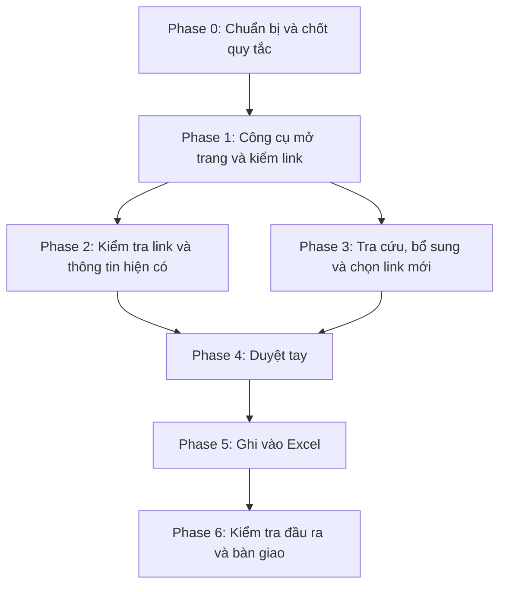

# PLAN CHÍNH THỨC: Kiểm tra, bổ sung và gắn link cho 128 ICD

File gốc: `Thông tin ICD 34 tỉnh năm 2026.xlsx`
File bàn giao: `Thông tin ICD 34 tỉnh năm 2026 - đã kiểm tra.xlsx`

Plan này gộp `plan.md` (bản Gemini), `plan-2.md` (bản nhận xét) và `plan-3.md` (bản chốt cùng kịch bản tự động). Khi có chỗ khác nhau, theo plan này.

## Quyết định đã chốt (Phase 0.1) — 30/10/2026

1. **Sửa ô gốc:** Chỉ ghi đề xuất vào sheet `Kiểm tra sai lệch` (và các cột/dòng mới). Không ghi đè ô gốc cho đến khi cô duyệt; sau duyệt mới sửa thẳng.
2. **API tìm kiếm:** Cascade trong `scripts/search.py` (Brave → Google → agent). Không rải ngày.
   1. **Brave Search** (ưu tiên; khóa spend trong credit free ~$5/tháng ≈ 1.000 query). Key: `BRAVE_API_KEY` trong `.env`.
   2. Hết quota/không có Brave → **Google Programmable Search (CSE)** nếu project còn bật được Custom Search JSON API (`GOOGLE_CSE_API_KEY` + `GOOGLE_CSE_CX`). Lưu ý: Google đã đóng API này với khách hàng mới; chỉ dùng nếu bạn còn/được cấp.
   3. **Bing Web Search v7 đã ngừng 11/08/2025** — không đăng ký key mới được; bỏ khỏi cascade thực tế.
   4. Hết API / chưa có key → agent tra trong phiên.
   Khi một provider hết quota, script ghi vào `cache/search_provider_state.json` và tự nhảy provider tiếp theo trong cùng phiên. API chỉ lấy ứng viên (P3.2); khớp ICD và duyệt tay vẫn bắt buộc.

---

## Yêu cầu của cô

1. Tra tự động và gắn link để kiểm tra thông tin có đúng không.
2. Biết ICD nào đang hoạt động, ICD nào chưa. Bổ sung thông tin còn thiếu, kèm link website hoặc link thông tin về ICD.
3. Kiểm tra xem có thông tin nào không đúng.

## Đầu ra cuối cùng

- **Sheet `Tổng hợp`** thêm 4 cột:
  - F – Tình trạng hoạt động (10/2026)
  - G – Link website / thông tin ICD
  - H – Kết quả kiểm tra thông tin
  - I – Ghi chú kiểm tra
- **128 sheet chi tiết**, trong đó sheet 08 là sheet tạo mới. Mỗi sheet thêm 4 dòng (13–16): trạng thái thực tế, link, nguồn kiểm chứng, kết quả kiểm tra. Các ô đang trống được điền nếu có nguồn.
- **Sheet mới `Kiểm tra sai lệch`**: mỗi chỗ sai một dòng, kèm link và đề xuất sửa.
- **Sheet mới `Thống kê`**: số ICD theo trạng thái, kết quả kiểm tra link, số sai lệch.
- **Thư mục `evidence/`**: ảnh chụp và nội dung chữ của mọi trang đã dùng làm nguồn.
- **Bản tóm tắt ngắn gửi cô.**

## Tổng quan các phase

Phase 1–3 đã đóng (30/10/2026). Phase 3 đã scale tối đa (0 URL ứng viên unchecked). Tiếp theo: Phase 4 duyệt tay → Phase 5 ghi Excel.

---

## Phase 0 – Chuẩn bị và chốt quy tắc

**P0.1 – Chốt 2 quyết định với cô hoặc với bạn**
- Sửa thẳng ô gốc hay chỉ ghi đề xuất vào sheet `Kiểm tra sai lệch`? Mặc định: chỉ ghi đề xuất (quy tắc R1).
- Có API key tìm kiếm không (Google Programmable Search, Brave hoặc Bing)? Nếu không có, bước tìm link ứng viên do agent tra trong phiên làm việc.
- *Xong khi:* hai quyết định đã ghi vào đầu file này.

**P0.2 – Sao lưu và dựng thư mục**
- Copy file gốc thành file bàn giao.
- Tạo các thư mục `scripts/`, `data/`, `evidence/`, `cache/`, `.browser-profile/`.
- *Xong khi:* file gốc không bị mở để ghi lần nào nữa.

**P0.3 – Trích dữ liệu ra CSV** (`scripts/extract.py`)
- Xuất sheet `Tổng hợp` và 127 sheet chi tiết ra `data/icd_hien_trang.csv`, mỗi dòng gồm STT, tên, sheet, hạng mục, nội dung, ô.
- *Xong khi:* có đủ 127 × 13 dòng hạng mục và 128 dòng tổng hợp.

**P0.4 – Lập bảng khóa ICD** (`data/icd_keys.csv`)
- Sinh tự động từ Excel. Mỗi ICD gồm:
  - tên chính và các tên gọi khác
  - tỉnh mới, tỉnh và huyện cũ
  - số quyết định
  - chủ đầu tư hoặc đơn vị khai thác
- Duyệt tay một lượt, nhất là các tên trùng (quy tắc R7).
- *Xong khi:* 128 dòng, mỗi ICD có ít nhất một khóa địa bàn.

---

## Phase 1 – Công cụ mở trang và kiểm link — **ĐÓNG 30/10/2026**

Đủ DoD: `fetch.py` (4 tầng) + `match.py` (khớp ICD) + `check_links.py` (CSV ổn định). Nghiệm thu: `python3 scripts/fetch.py test`, `match.py test`, `check_links.py test`. Tiếp theo: Phase 2 và 3 (song song được).

**P1.1 – `scripts/fetch.py`: mở trang theo 4 tầng** (chi tiết ở Phụ lục C) — **XONG 30/10/2026**
- Tầng 1, `httpx`:
  - header như Chrome, thử lại 2 lần
  - lỗi SSL thì thử lại bỏ kiểm chứng chỉ và gắn cờ
  - PDF thì trích chữ bằng `pdfplumber`, dự phòng `fitz`
- Tầng 2, Playwright chạy Chrome ẩn.
- Tầng 3, Playwright chạy Chrome có giao diện, giữ cookie trong `.browser-profile/`, chạy tuần tự, chờ tối đa 25 giây (stealth để qua Cloudflare).
- Tầng 4: không tự vượt, chuyển sang tìm nguồn thay thế hoặc đưa vào `data/can_mo_tay.csv`.
- Cache 7 ngày. Mỗi tên miền 1 request mỗi 3–5 giây. Lưu ảnh chụp, chữ trích và thời điểm vào `evidence/`.
- *Xong khi:* chạy thử đúng như lần thử ngày 28/10:
  - thuvienphapluat qua được ở tầng 3
  - vimawa mở được với cờ SSL
  - mt.gov.vn ra `LINK_CHẾT`
  - baochinhphu không bị nhận nhầm là bị chặn
- *Kết quả nghiệm thu 30/10/2026 (`python3 scripts/fetch.py test`):* 4/4 PASS. Ghi chú: node `vimawa.gov.vn/vi/node/15406` hiện trả Drupal Access denied (khác 28/10); SSL fallback vẫn đúng — cần nguồn thay ở P2.

**P1.2 – `scripts/match.py`: chấm "trang có đúng ICD không"** (Phụ lục D) — **XONG 30/10/2026**
- Khớp khi tên giống từ 90 trở lên (theo `rapidfuzz`, sau khi bỏ dấu) **và** có ít nhất một khóa phụ.
- Trang nhắc từ 3 ICD khác trở lên thì xếp `CHỈ_KHỚP_CHUNG`.
- Địa bàn trên trang thuộc ICD khác thì chuyển link cho ICD đó.
- *Xong khi:* chấm đúng các ca mẫu: 3 dòng Long Bình, 2 dòng Tân Lập, Thạnh Phước và Thanh Phước, link QĐ 979.
- *Kết quả nghiệm thu 30/10/2026 (`python3 scripts/match.py test`):* 10/10 PASS (gồm ca chuyển địa bàn Long Bình 15→126 và Thạnh Phước 18→116).

**P1.3 – `scripts/check_links.py`: ghi kết quả kiểm link** — **XONG 30/10/2026**
- Nhận danh sách URL, gọi `fetch.py` rồi `match.py`.
- Ghi ra `data/link_check.csv` với các cột: STT, URL, nguồn, tầng mở được, mã HTTP, URL cuối, tiêu đề, loại nội dung, trạng thái (Phụ lục B), lý do, khớp tên, khớp địa bàn, số ICD khác được nhắc, ảnh chụp, thời điểm.
- *Xong khi:* chạy lại nhiều lần trên cùng URL cho cùng kết quả.
- *Kết quả nghiệm thu 30/10/2026 (`python3 scripts/check_links.py test`):* 2 lần cùng URL → cùng status; lần 2 lấy từ cache. Chạy cả cột E: `python3 scripts/check_links.py tong-hop`.

---

## Phase 2 – Kiểm tra link và thông tin hiện có (yêu cầu 1 và 3) — **ĐÓNG 30/10/2026**

Đủ DoD: `data/link_check.csv` (30/30 URL cột E) + `data/sai_lech.csv` (P2.1–P2.4) + `scripts/phase2_sai_lech.py`. Nghiệm thu: `python3 scripts/check_links.py tong-hop` rồi `python3 scripts/phase2_sai_lech.py`. Tiếp theo: Phase 3 (song song được) hoặc Phase 4 sau khi có đủ đề xuất.

**P2.1 – Kiểm 30 link khác nhau ở cột E** — **XONG 30/10/2026**
- Chạy `check_links.py` cho toàn bộ cột E.
- Mọi link `LINK_CHẾT`, `MỞ_ĐƯỢC_KHÔNG_KHỚP`, link trùng giữa hai ICD, hoặc link nhóm QĐ 428 chỉ đạt `CHỈ_KHỚP_CHUNG` đều được ghi vào `data/sai_lech.csv`.
- *Xong khi:* 30/30 link có trạng thái. Không còn link nào `BỊ_CHẶN` mà chưa có nguồn thay thế hoặc chưa được mở tay.
- *Kết quả 30/10/2026:* 30 unique URL — `MỞ_ĐƯỢC_KHỚP` 3, `CHỈ_KHỚP_CHUNG` 9, `LINK_CHẾT` 2, `MỞ_ĐƯỢC_KHÔNG_KHỚP` 1, `LỖI_SSL_MỞ_ĐƯỢC` 1, `BỊ_CHẶN` 14 (TVPL Cloudflare). Mọi `BỊ_CHẶN` đã có nguồn thay (cổng tỉnh / luatvietnam / vanban.chinhphu) hoặc đưa vào `data/can_mo_tay.csv` (STT 21, 27, 31, 40, 123, 126).

**P2.2 – Kiểm các điểm nghi sai đã biết** (Phụ lục E, mục 0–9) — **XONG 30/10/2026**
- Với từng điểm: tìm văn bản gốc, rồi kết luận "đúng", "sai" hoặc "chưa đủ nguồn", kèm link.
- *Xong khi:* mỗi điểm có một dòng kết luận trong `data/sai_lech.csv`.
- *Kết quả:* E.0–E.7 = sai (có đề xuất + link thay); E.8 QH tỉnh = đúng; E.9 nhóm 428 = ghi_nhan (chi tiết lệch ở P2.3).

**P2.3 – Đối chiếu số và ngày quyết định** — **XONG 30/10/2026**
- 19 quyết định mở cảng của nhóm QĐ 428, gồm tra số còn thiếu cho STT 9 và STT 15.
- Các văn bản quy hoạch tỉnh: 2279 (Khánh Hòa), 5455 (Hải Phòng), 568 (Ninh Bình), 779 (Đồng Nai), 01/NQ-HĐND (Lai Châu, Cà Mau).
- *Xong khi:* mỗi số quyết định có link văn bản gốc và kết luận khớp hoặc lệch.
- *Phát hiện chính:* STT 9 → `1246/QĐ-BGTVT`; STT 15 → `07/QĐ-BGTVT` (06/01/2023); STT 4 ngày sai (2015→2016); STT 13 số sai (`684`→`584`); STT 8 mở bằng `1543/QĐ-BGTVT` (19/8/2021). QH tỉnh 2279/5455/568/779/01-NQ khớp nguồn công khai; Cà Mau bổ sung ngày 25/02/2026.

**P2.4 – Quét lỗi định dạng và ghi chú nội bộ trong toàn file** — **XONG 30/10/2026**
- Số thập phân lỗi như `8,1910900000000009`.
- Chữ "Excel gốc".
- Cụm "cần tra cứu số".
- Tên ở sheet chi tiết lệch tên ở `Tổng hợp`.
- *Xong khi:* đã quét cả 127 sheet, kết quả nằm trong `data/sai_lech.csv`.
- *Kết quả:* float STT 10 & 18; "Excel gốc" STT 19 (4 ô); "cần tra cứu số" STT 9 & 15; không lệch tên Tổng hợp ↔ chi tiết.

---

## Phase 3 – Tra cứu, bổ sung và chọn link mới (yêu cầu 1 và 2) — **ĐÓNG 30/10/2026**

Đủ DoD (scale tối đa): `ung_vien.csv` (128 STT × ≥2 query) + `ung_vien_check.csv` (**0 URL unchecked**, 663 dòng) + `verify_website.py` + `link_chon.csv` (128; **44** có URL G, QĐ 428 **19/19**) + `trang_thai_de_xuat.csv` (128) + `tra_cuu.csv` + `phase3_report.html` / `phase3_summary.json`. Nghiệm thu: `verify_website.py test`, `pick_links.py test`, `propose_status.py test`, `check_links.py ung-vien --unchecked-only --per-stt 0`. Tiếp theo: Phase 4 duyệt tay (ưu tiên mọi dòng Đang hoạt động / Đang xây dựng và ~36 link G ghi chú cần P4).

**P3.1 – Lấy danh mục mạng lưới của các nhà khai thác** — **XONG 30/10/2026**
- Đọc trang "mạng lưới / hệ thống ICD" của Tân Cảng Sài Gòn, Gemadept, VIMC, TBS, Transimex, Hateco, Sotrans.
- Ghép tên ICD với URL vào `data/ung_vien.csv` (`scripts/phase3_operators.py` → `operator_networks.json`).
- *Kết quả:* 7/7 nhà khai thác; 23 dòng `operator_network` (18 khớp STT).

**P3.2 – Tìm link ứng viên theo 3 lô** — **XONG 30/10/2026**
- Cascade Brave → Google qua `scripts/search.py` / `phase3_search.py` (không cào SERP HTML).
- Lô A (19 QĐ 428) + Lô B (trùng tên / nghi đang chạy) + Lô C (còn lại).
- *Kết quả:* 128/128 STT ≥2 query; ~662 URL ứng viên unique trong `ung_vien.csv`.

**P3.3 – Kiểm từng link ứng viên** — **XONG 30/10/2026**
- `check_links.py ung-vien --unchecked-only --per-stt 0` (có `--max-tier`).
- *Kết quả:* 0 unchecked; `MỞ_ĐƯỢC_KHỚP` 167 · `CHỈ_KHỚP_CHUNG` 313 · còn lại LINK_CHẾT / KHÔNG_KHỚP / BỊ_CHẶN (TVPL Cloudflare). Chi tiết: `phase3_scale_check.json`.

**P3.4 – `scripts/verify_website.py`: xác minh website chính chủ** (Phụ lục F) — **XONG 30/10/2026**
- Tín hiệu S1–S3 / P1–P2; loại danh bạ. CLI: `test` | `<stt> <url>` | `from-csv`.
- *Kết quả nghiệm thu:* unit test PASS; `website_verify.csv` có kết luận chính thức / có khả năng / loại.

**P3.5 – `scripts/pick_links.py`: chọn link cho cột G** — **XONG 30/10/2026**
- Ưu tiên: website đã xác minh → VB nhà nước riêng → báo riêng (≤24 tháng).
- *Kết quả:* 128 dòng `link_chon.csv`; 44 có URL G (QĐ 428 đủ 19/19); 84 trống có lý do (không đoán).

**P3.6 – Trích thông tin bổ sung** — **XONG 30/10/2026** (`extract_tra_cuu.py`)
- *Kết quả:* `tra_cuu.csv` — chỉ giá trị có URL + câu trích (không nguồn thì không điền).

**P3.7 – Máy đề xuất trạng thái hoạt động** — **XONG 30/10/2026** (`propose_status.py`)
- *Kết quả:* 128/128 trong `trang_thai_de_xuat.csv` (máy đề xuất; bắt buộc duyệt tay ở P4 trước khi ghi Excel).

---

## Phase 4 – Duyệt tay (bắt buộc trước khi ghi Excel)

**P4.1 – Tạo file duyệt `data/review.xlsx`**
- Gộp đề xuất trạng thái, link chọn, thông tin bổ sung và sai lệch.
- Mỗi dòng có câu trích, link, ảnh chụp, và cột "Đồng ý / Sửa / Hạ xuống Chưa đủ thông tin".

**P4.2 – Duyệt**
- Bắt buộc duyệt:
  - mọi dòng `Đang hoạt động` hoặc `Đang xây dựng`
  - mọi sai lệch
  - mọi ICD trùng tên
  - mọi website "có khả năng"
- Mở các link trong `can_mo_tay.csv` bằng Chrome thường và đánh dấu `ĐÃ_XÁC_MINH_TAY`.
- *Xong khi:* không còn dòng chưa duyệt. Dòng nào nghi ngờ thì đã hạ xuống `Chưa đủ thông tin`.

---

## Phase 5 – Ghi vào Excel (`scripts/build_excel.py`)

**P5.1 – Tạo sheet 08 Tân Cảng Quế Võ**
- Nhân bản sheet `09 Tiên Sơn` để giữ định dạng, đặt giữa sheet 07 và 09.
- Nội dung theo giọng các sheet nhóm QĐ 428. Chỉ ghi những gì có văn bản gốc.

**P5.2 – Sheet `Tổng hợp`**
- Thêm cột F–I, nới merge tiêu đề từ `A1:E1` ra `A1:I1`.
- Định dạng copy từ cột E. Link ở cột G là hyperlink bấm được.

**P5.3 – Sheet chi tiết**
- Thêm dòng 13–16 cho cả 128 sheet.
- Điền các ô đang trống đã duyệt. Mỗi giá trị ghi nguồn ở cuối, ví dụ `(nguồn: tancang.com.vn, 10/2026)`.

**P5.4 – Tạo sheet `Kiểm tra sai lệch` và `Thống kê`**
- Các cột của sheet sai lệch: STT, Tên ICD, Sheet, Hạng mục, Nội dung hiện tại, Phát hiện, Link nguồn, Loại, Đề xuất sửa.
- *Xong khi (cả phase):* file mở được bằng Excel, định dạng không bị vỡ.

---

## Phase 6 – Kiểm tra đầu ra và bàn giao

**P6.1 – `scripts/verify.py`**
- 0 ô gốc bị đổi (so từng ô với file gốc).
- Đủ sheet 01–128, đúng thứ tự.
- 128/128 ICD có giá trị ở cột F.
- Mọi dòng có F khác `Chưa đủ thông tin` đều có link ở G, và link đó không phải URL chung của QĐ 979.
- Mọi giá trị bổ sung đều ghi nguồn.

**P6.2 – Kiểm lại toàn bộ link một ngày trước khi gửi**
- Chạy lại `check_links.py` cho mọi link trong file đầu ra.
- Mọi link phải ở trạng thái `MỞ_ĐƯỢC_KHỚP` hoặc `ĐÃ_XÁC_MINH_TAY`.

**P6.3 – Viết tóm tắt gửi cô**
- Số ICD theo từng trạng thái.
- Số link lỗi đã thay.
- Số sai lệch theo loại.
- Danh sách đề xuất sửa cần cô quyết.

---

## Phụ lục A – Thang trạng thái hoạt động (cột F)

- **Đang hoạt động**: có ít nhất một trong các bằng chứng:
  - website doanh nghiệp giới thiệu ICD, có địa chỉ khớp
  - văn bản Hải quan về địa điểm làm thủ tục tại ICD
  - bài báo chính thống trong 24 tháng nói về khai thác hoặc sản lượng
- **Đã công bố mở, chưa xác nhận đang khai thác**: có quyết định mở cảng nhưng chưa có bằng chứng vận hành.
- **Đang xây dựng / chuẩn bị đầu tư**: có chủ đầu tư, chủ trương đầu tư, đã khởi công hoặc đang giải phóng mặt bằng, kèm nguồn.
- **Chưa triển khai (mới quy hoạch)**: đã tìm ít nhất 2 lượt, không thấy dự án. Link là văn bản quy hoạch, ghi ngày tra.
- **Đã ngừng / di dời**: có nguồn xác nhận.
- **Chưa đủ thông tin**: nguồn mâu thuẫn hoặc không tra được.

## Phụ lục B – Trạng thái của một link

- `MỞ_ĐƯỢC_KHỚP`: mở được, trang nhắc đúng tên ICD và có ít nhất một khóa phụ.
- `CHỈ_KHỚP_CHUNG`: văn bản hoặc bài chung cho nhiều ICD. Chỉ dùng ở cột E, không dùng cho cột G.
- `MỞ_ĐƯỢC_KHÔNG_KHỚP`: mở được nhưng không thấy ICD, hoặc trang nói về ICD trùng tên ở địa bàn khác.
- `LINK_CHẾT`: 404 hoặc 410, lỗi DNS, trang báo lỗi nhưng trả mã 200, hoặc bị chuyển về trang chủ.
- `LỖI_SSL_MỞ_ĐƯỢC`: chỉ mở được khi bỏ qua chứng chỉ. Vẫn dùng được, có ghi chú.
- `BỊ_CHẶN`: qua 3 tầng tự động vẫn bị chặn.
- `ĐÃ_XÁC_MINH_TAY`: người mở và xác nhận, ghi tên người kiểm và ngày.

## Phụ lục C – Mở trang và xử lý chặn bot

1. **Kết quả chạy thử ngày 28/10/2026 trên 30 link của cột E:**
   - 13 link mở được bằng script thường.
   - 15 link thuvienphapluat bị Cloudflare chặn (403). Chrome ẩn vẫn bị chặn. Chrome có giao diện qua được sau khoảng 4 giây.
   - 2 link lỗi SSL: vimawa mở được khi bỏ kiểm chứng chỉ; mt.gov.vn trả 404.
2. **Chuyển từ tầng 1 lên tầng 2** khi gặp một trong các dấu hiệu:
   - mã 403, 429 hoặc 503 kèm tiêu đề trang chờ ("Just a moment", "Chờ một chút", "Attention Required")
   - HTML dưới khoảng 10 KB mà gần như không có chữ
   - nội dung rỗng vì trang cần JavaScript

   Không kết luận "bị chặn" chỉ vì mã nguồn có chữ "captcha". baochinhphu đã bị bắt nhầm như vậy.
3. **Tầng 4**: gặp CAPTCHA bắt thao tác, trang đòi đăng nhập, hoặc trang trả phí thì không dùng dịch vụ giải CAPTCHA hay giả mạo. Thay vào đó:
   - tìm cùng văn bản ở vanban.chinhphu.vn, congbao.chinhphu.vn, moc.gov.vn, luatvietnam.vn hoặc cổng thông tin tỉnh;
   - nếu không có, chuyển sang mở tay.
4. **Lịch sự và bằng chứng:**
   - chỉ mở đúng các URL cần kiểm, không cào cả website
   - cache 7 ngày
   - mỗi trang lưu ảnh chụp và chữ trích; tùy chọn gửi lên Wayback Machine
5. **Từ khóa để đề xuất trạng thái:**
   - Đang hoạt động: "đi vào hoạt động", "khánh thành", "sản lượng ... TEU" từ năm 2024, "tiếp nhận chuyến hàng"; hoặc website có biểu giá, lịch khai thác
   - Đang xây dựng: "khởi công", "chấp thuận chủ trương đầu tư", "giải phóng mặt bằng", "đang thi công"
   - Nguồn mâu thuẫn: Chưa đủ thông tin

## Phụ lục D – Chấm khớp ICD

- Chuẩn hóa trước khi so: bỏ dấu, chuyển chữ thường, bỏ các cụm "cảng cạn", "ICD", "giai đoạn 1", "Công ty CP", "TNHH".
- Khớp khi tên giống từ 90 trở lên **và** có ít nhất một khóa phụ (địa bàn, số quyết định, chủ đầu tư).
- Các nhóm tên trùng cần chú ý: xem quy tắc R7.

## Phụ lục E – Các điểm nghi sai đã thấy trong file

0. Link STT 1 (`mt.gov.vn`) đã chết, trả 404. Cần tìm QĐ 1549/QĐ-BGTVT ở nguồn khác.
1. STT 3 và 4 dùng chung link `vimawa.gov.vn/vi/node/15406`. Đây là bài chung về danh sách 19 cảng cạn, không riêng ICD nào.
2. Link STT 2 (Hải Linh) là PDF nghị quyết HĐND Phú Thọ, không phải quyết định mở cảng.
3. Link STT 12 là quy hoạch tỉnh Hà Nam (1686/QĐ-TTg), không phải 1007/QĐ-BGTVT. Link STT 13 là QĐ 979, không phải 684/QĐ-BGTVT.
4. Link STT 8 (Quế Võ) là bài về cảng cạn quy hoạch, không phải quyết định mở cảng.
5. STT 9 (Tiên Sơn) và STT 15 (Tân Cảng Long Bình) chưa có số quyết định mở cảng.
6. Lỗi số thập phân: STT 10 ghi `8,1910900000000009 ha` (đúng là 8,19109 ha), STT 18 ghi `9,6477599999999999 ha` (đúng là 9,64776 ha).
7. STT 19 còn chữ "EXCEL GỐC" hoặc "Excel gốc" trong 4 ô.
8. Cần kiểm lại số, ngày và tình trạng phê duyệt của các văn bản quy hoạch tỉnh: 2279, 5455, 568, 779, 01/NQ-HĐND.
9. Số và ngày quyết định mở cảng của cả 19 ICD nhóm QĐ 428. Nhiều dòng đang ghi "theo tài liệu lịch sử".
10. Sóng Thần (106), TBS Tân Vạn (107) và Long Bình TP.HCM (98) có thể đang hoạt động dù file ghi là quy hoạch. Nếu đúng: ghi vào cột F, giải thích ở cột I, ô `Tình trạng` giữ nguyên.

## Phụ lục F – Xác minh website chính chủ

- `whois` không dùng được: với tên miền `.vn` chỉ trả thông tin chung của VNNIC.
- **Tín hiệu mạnh:**
  - S1: mã số thuế ở chân trang trùng với nguồn độc lập (quyết định mở cảng, báo cáo thường niên, Cổng đăng ký doanh nghiệp – phải tra tay)
  - S2: tên pháp nhân và địa chỉ khớp với quyết định mở cảng
  - S3: được website tập đoàn mẹ hoặc văn bản nhà nước trỏ tới
- **Tín hiệu phụ:**
  - P1: tên miền chứa thương hiệu
  - P2: nội dung chuyên về ICD, cập nhật trong 12 tháng
- **Loại ngay:** masothue, trangvangvietnam, hosocongty, infodoanhnghiep, trang tin tổng hợp, trang tên giống nhưng mã số thuế hoặc địa chỉ khác. Fanpage chỉ dùng khi doanh nghiệp không có website, và ghi rõ là "Fanpage".
- **Kết luận:**
  - Từ 2 tín hiệu mạnh, hoặc 1 mạnh và 2 phụ: website chính thức, ghi vào cột G.
  - Ít hơn: ghi "cần xác nhận" ở cột I.
  - Tập đoàn mẹ có trang riêng cho ICD thì dùng trang con đó.

## Quy tắc bắt buộc

- **R1.** Không ghi đè ô gốc. Chỗ sai ghi vào `Kiểm tra sai lệch` kèm đề xuất. Cô duyệt xong mới sửa.
- **R2.** Chỉ điền vào ô trống, hoặc vào cột hay dòng mới.
- **R3.** Không có link thì không điền.
- **R4.** Link ở cột G phải nói riêng về ICD đó. Không dùng URL chung của QĐ 979.
- **R5.** "Đã công bố mở" chưa có nghĩa là "đang hoạt động".
- **R6.** Giữ bản đồ 34 tỉnh. Khi tra cứu, tìm theo cả tên tỉnh cũ và tỉnh mới.
- **R7.** Tên trùng phải khớp cả địa bàn:
  - Long Bình: 15 (Đồng Nai), 98 (TP.HCM cũ), 126 (An Giang)
  - Tân Lập: 58 (Hưng Yên), 121 (Long An)
  - Thạnh Phước (18) khác Thanh Phước (116)
  - Cái Mép (17) khác Phước Hòa – Cái Mép (115)
  - Thanh Thủy: 21 (Tuyên Quang), 71 (Nghệ An)
  - Quế Võ (08) khác Mộc Bài (19)
- **R8.** Chỉ làm trên bản sao.

## Nguồn gốc các phần trong plan

- **Từ `plan.md`:**
  - khung hai lớp pháp lý và thực tế
  - thêm cột trạng thái và cột link
  - tạo sheet 08
  - dùng openpyxl
  - có phần thống kê
- **Từ `plan-2.md`:**
  - tách "đã công bố mở" khỏi "đang hoạt động"
  - khóa thêm Số QĐ, Vị trí, Quy mô
  - không có nguồn thì không điền
  - chú ý tên trùng
  - duyệt tay trước khi ghi
- **Từ `plan-3.md`:**
  - sheet `Kiểm tra sai lệch`
  - danh sách nghi sai
  - mở trang 4 tầng
  - chấm khớp ICD
  - xác minh website chính chủ
  - script kiểm tra đầu ra
- **Đã bỏ:**
  - nhóm "Đặc thù" với ví dụ Trường Thọ (không có trong file)
  - tra VNACCS như một API
  - trạng thái "Sẵn sàng" khi chưa có script
