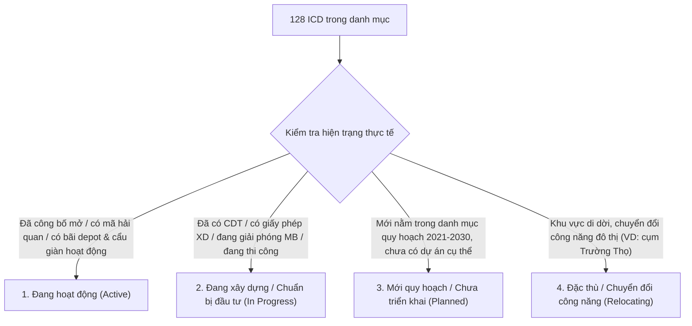

# KẾ HOẠCH NÂNG CẤP VÀ LÀM GIÀU DỮ LIỆU FILE EXCEL

## Dự án: "Thông tin ICD 34 tỉnh năm 2026"

---

## 1. Bối cảnh dự án & Nguyên tắc tiếp cận cốt lõi

### 1.1. Bối cảnh nghiên cứu

* **Tên file & chủ đề**: `Thông tin ICD 34 tỉnh năm 2026.xlsx` (Sheet `Tổng hợp ICD 34 tỉnh thành`).
* **Bối cảnh không gian**: Toàn bộ dữ liệu được xây dựng dựa trên kịch bản / đề tài nghiên cứu về **sắp xếp, sáp nhập tinh gọn đơn vị hành chính cấp tỉnh về quy mô 34 tỉnh/thành phố trực thuộc Trung ương giai đoạn đến năm 2026–2030**.
* **Đặc thù địa giới hành chính**:
  * Các ICD khu vực Hải Dương nằm dưới quy hoạch tỉnh Hải Phòng (QĐ 5455/QĐ-UBND).
  * Các ICD khu vực Hà Nam, Nam Định nằm dưới quy hoạch tỉnh Ninh Bình (QĐ 568/QĐ-UBND).
  * Các ICD khu vực Ninh Thuận nằm dưới quy hoạch tỉnh Khánh Hòa (QĐ 2279/QĐ-UBND).
  * *Nguyên tắc bắt buộc*: **Tuyệt đối tôn trọng và giữ nguyên cấu trúc 34 tỉnh thành theo định hướng của đề tài**, không tự ý quy đổi ngược lại bản đồ 63 tỉnh cũ.

### 1.2. Nguyên tắc bảo toàn dữ liệu gốc (Data Integrity)

* **Bảo toàn 100% thẩm định pháp lý**: Toàn bộ nội dung hiện tại trong các ô `Tình trạng` mang tính chuẩn mực pháp lý cao (thẩm tra theo QĐ 979, QĐ 428, các QĐ quy hoạch tỉnh) đã được giảng viên duyệt $\rightarrow$ **Giữ nguyên vẹn, không chỉnh sửa hay xóa bỏ**.
* **Tiếp cận theo mô hình "Song hành hai lớp" (Two-Layer Approach)**:
  * **Lớp 1 - Pháp lý & Quy hoạch (Legal / Planning Layer)**: Giữ nguyên các cột/dòng hiện có (`Tình trạng`, `Link đối chiếu`).
  * **Lớp 2 - Thực tế vận hành (Operational Reality Layer)**: Bổ sung mới hoàn toàn các trường thông tin (`Tình trạng thực tế 2026`, `Link thực tế / Website`) để trả lời trực tiếp câu hỏi: *Ngoài đời thực cảng đã hoạt động chưa, đang xây hay vẫn là đất trống?*

---

## 2. Kết quả rà soát hiện trạng file Excel

| Tiêu chí                          | Hiện trạng kiểm tra                                                                                                                                                                                                                              | Đánh giá & Hướng xử lý                                                                                                                                                                                                            |
| :-------------------------------- | :----------------------------------------------------------------------------------------------------------------------------------------------------------------------------------------------------------------------------------------------- | :-------------------------------------------------------------------------------------------------------------------------------------------------------------------------------------------------------------------------------- |
| **Cấu trúc Sheet**                | 1 sheet `Tổng hợp` (128 ICD) + 127 sheet chi tiết.                                                                                                                                                                                               | **Thiếu sheet chi tiết** `08` (Cảng cạn Tân Cảng Quế Võ, nhảy từ sheet 07 sang 09). $\rightarrow$ Cần tạo bổ sung sheet 08.                                                                                                       |
| **Hiện trạng Link**               | • 91 link `vanban.chinhphu.vn` (QĐ 979/QĐ-TTg) • 22 link `thuvienphapluat.vn` (Quy hoạch tỉnh / QĐ mở cảng) • 15 link báo chí, cổng thông tin bộ ngành.                                                                                          | Cả 91 link Chính phủ và 22 link Thư Viện Pháp Luật đều là **văn bản pháp luật / quy hoạch hành chính**, chưa phản ánh website thương mại hay tiến độ thực tế ngoài đời của ICD. $\rightarrow$ Cần bổ sung cột link thực tế riêng. |
| **Mức độ hoàn thiện (Fill rate)** | • **STT 1 – 19**: 19 cảng cạn đã có QĐ công bố mở (QĐ 428/QĐ-BXD) có thông tin tương đối đầy đủ. • **STT 20 – 128**: 109 ICD lấy từ quy hoạch định hướng đang để trống phần lớn các trường (Chủ đầu tư, Đơn vị khai thác, Dịch vụ, Hãng tàu...). | Giữ nguyên các phân tích pháp lý, tập trung tra cứu bổ sung thông tin cho các ICD đã có dự án triển khai hoặc đang hoạt động ngoài đời thực.                                                                                      |

---

## 3. Khung phân loại "Tình trạng thực tế (2026)" (Taxonomy)

Mỗi ICD sẽ được gán 1 trong 4 trạng thái vận hành cụ thể:

1. **Nhóm 1 - Đang hoạt động (Active)**:
   * *Đặc điểm*: Đã có quyết định mở cảng, mã cảng Hải quan (VNACCS), có bãi depot/cẩu giàn tiếp nhận hàng hóa.
   * *Thông tin cần có*: Chủ đầu tư, Đơn vị vận hành, Quy mô diện tích thực tế, Dịch vụ cung cấp, Hãng tàu kết nối + Link website doanh nghiệp / cổng thông tin.
2. **Nhóm 2 - Đang xây dựng / Chuẩn bị đầu tư (In Progress)**:
   * *Đặc điểm*: Đã chấp thuận chủ trương đầu tư, đã có Chủ đầu tư, đang giải phóng mặt bằng hoặc thi công xây dựng.
   * *Thông tin cần có*: Tên Chủ đầu tư, vốn đầu tư, tiến độ dự kiến hoàn thành + Link bài báo chính thống cập nhật tiến độ.
3. **Nhóm 3 - Mới quy hoạch / Chưa triển khai (Planned)**:
   * *Đặc điểm*: Mới là chỉ tiêu phân bổ quỹ đất trong QĐ 979 hoặc quy hoạch tỉnh 2021–2030; chưa có pháp nhân dự án.
   * *Ghi chú chuẩn*: *"Quy hoạch định hướng giai đoạn 2021-2030; hiện trạng chưa triển khai dự án đầu tư thực tế."*
4. **Nhóm 4 - Đặc thù / Chuyển đổi công năng (Relocating / Special)**:
   * *Đặc điểm*: Các ICD cũ nằm trong diện chỉnh trang đô thị, di dời vị trí sang cụm mới (ví dụ: cụm ICD Trường Thọ).

---

## 4. Kế hoạch triển khai chi tiết 4 giai đoạn

### Giai đoạn 1: Chuẩn hóa cấu trúc file Excel (Structural Setup)

1. **Bổ sung sheet chi tiết** `08 Tân Cảng Quế Võ`:
   * Nhân bản đúng định dạng bảng, màu sắc, font chữ và công thức của các sheet chi tiết lân cận.
   * Điền thông tin chuẩn cho Cảng cạn Tân Cảng Quế Võ (Chủ đầu tư: Tổng công ty Tân Cảng Sài Gòn; vị trí: KCN Quế Võ, tỉnh Bắc Ninh; đã công bố mở cảng).
2. **Nâng cấp Sheet** `Tổng hợp`:
   * Giữ nguyên các cột hiện tại: `STT`, `Tên ICD`, `Miền`, `Pháp lý`, `Link đối chiếu (Pháp lý)`.
   * Thêm cột F: `Tình trạng thực tế (2026)` (gán 1 trong 4 nhóm trạng thái).
   * Thêm cột G: `Link đối chiếu thực tế / Website` (Website doanh nghiệp hoặc báo chí chính thống).
3. **Nâng cấp 128 Sheet chi tiết**:
   * Giữ nguyên dòng `Tình trạng` (pháp lý quy hoạch).
   * Thêm dòng phụ hoặc mở rộng mục: `Tình trạng thực tế (2026)` và `Nguồn kiểm chứng thực tế`.

### Giai đoạn 2: Xây dựng Pipeline tra cứu & Thu thập dữ liệu đa nguồn

Triển khai script Python tra cứu cross-check từ 3 tầng thông tin:

* **Tầng 1 (Cơ quan quản lý & Hải quan)**:
  * Tra cứu Danh bạ mã địa điểm lưu kho / mã cảng ICD trên Cổng thông tin Tổng cục Hải quan (VNACCS).
  * Đối chiếu các quyết định công bố mở cảng mới nhất từ Bộ Giao thông vận tải / Cục Hàng hải Việt Nam.
* **Tầng 2 (Mạng lưới nhà khai thác cảng & logistics lớn)**:
  * Tổng công ty Tân Cảng Sài Gòn (SNP), Gemadept, VIMC Logistics, TBS Logistics, Hateco Logistics, v.v.
  * Lấy website chính thức, năng lực bãi, hãng tàu đang liên kết khai thác.
* **Tầng 3 (Cổng thông tin địa phương & Báo chí kinh tế uy tín)**:
  * Báo Đầu tư, Báo Đấu thầu, Cổng TTĐT các tỉnh/thành phố.
  * Tìm kiếm theo cú pháp chuẩn: `"Cảng cạn [Tên ICD]"` hoặc `"ICD [Tên ICD]"` đi kèm `("khởi công" OR "khánh thành" OR "tiến độ" OR "chủ đầu tư")`.

### Giai đoạn 3: Rà soát dữ liệu & Làm giàu thông tin (Data Enrichment)

* **Với nhóm Đang hoạt động**: Bổ sung đầy đủ thông tin Chủ đầu tư, Đơn vị vận hành, Dịch vụ, Hãng tàu và gắn link website chính thức.
* **Với nhóm Đang xây dựng**: Bổ sung thông tin Chủ đầu tư, tiến độ, năm dự kiến khánh thành và gắn link báo chí chính thức.
* **Với nhóm Mới quy hoạch**: Chuẩn hóa nội dung ghi chú rõ ràng là quy hoạch tiềm năng, giữ nguyên link văn bản quy hoạch tỉnh/QĐ 979, không để cô giáo cảm thấy dữ liệu bị bỏ sót.

### Giai đoạn 4: Cập nhật trực tiếp Excel & Báo cáo tổng kết

1. Dùng thư viện `openpyxl` cập nhật trực tiếp vào file `Thông tin ICD 34 tỉnh năm 2026.xlsx` mà không làm vỡ định dạng ban đầu.
2. Xuất bảng thống kê tổng hợp (Executive Summary):
   * Tỷ lệ % ICD Đang hoạt động vs Đang xây dựng vs Mới quy hoạch.
   * Bảng danh mục đối chiếu link pháp lý vs link thực tế.
   * Ghi chú hướng dẫn nghiệm thu dành cho cô giáo.

---

## 5. Bảng phân công & Lộ trình thực hiện dự kiến

| Bước | Nhiệm vụ cụ thể | Đầu ra bàn giao | Trạng thái |
| :---: | :--- | :--- | :---: |
| **B1** | Tạo sheet 08 Quế Võ & thêm cột Tình trạng thực tế, Link thực tế vào file Excel | File Excel có đủ 128 sheet chi tiết & cấu trúc cột mới | Sẵn sàng |
| **B2** | Chạy script thu thập dữ liệu & phân loại 128 ICD theo 4 nhóm | File dữ liệu trung gian (JSON/CSV) phân loại chi tiết | Sẵn sàng |
| **B3** | Rà soát chéo các ICD trọng điểm (Tân Cảng, Gemadept, VIMC, các dự án lớn) | Bộ dữ liệu sạch đầy đủ link & thông tin vận hành | Chờ duyệt |
| **B4** | Ghi dữ liệu vào file Excel hoàn thiện và lập báo cáo nghiệm thu gửi cô | File Excel hoàn thiện + File tóm tắt gửi cô giáo | Chờ duyệt |
